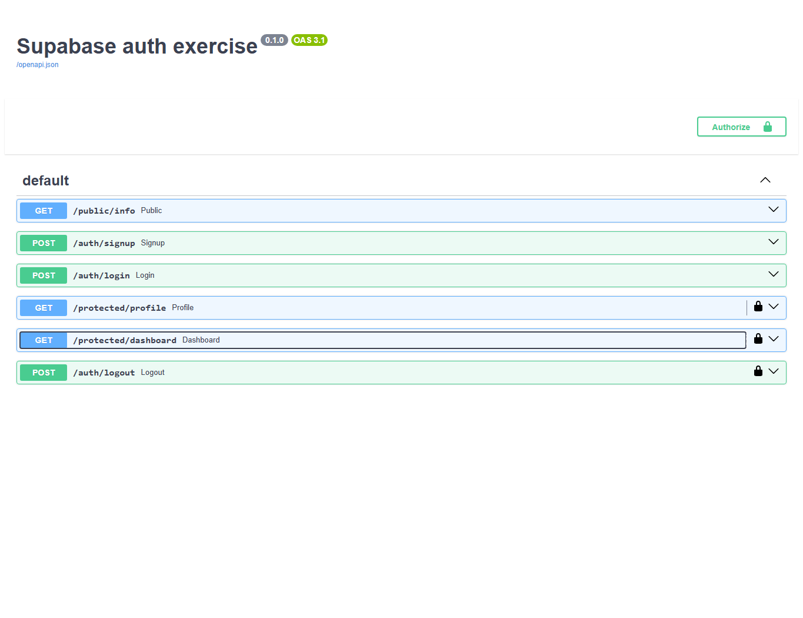

# Supabase authentication API

Python/FastAPI API using Supabase Auth for signup, login, token verification and logout. Supabase manages passwords; this app does not store passwords or implement password hashing.

## Setup and run

Create a Supabase project. Enable Email sign-in and allow new users to sign up. For this practice exercise, disable Confirm email so a newly created account can log in immediately. If you keep email confirmation enabled, confirm the account before login.

Open a terminal in the repository directory. On Windows PowerShell:

```powershell
Copy-Item .env.example .env
pip install -r requirements.txt
```

On macOS/Linux, use `cp .env.example .env` for the first command. Fill in `.env` locally:

| Variable | Value |
|---|---|
| SUPABASE_URL | Your project's HTTPS URL |
| SUPABASE_KEY | Your publishable key or legacy anon key |

Use a publishable/anon key, never a service role key. Keep `.env` out of Git. Start the API with one command:

```sh
uvicorn app:app --reload --port 8008
```

Open http://localhost:8008/docs for Swagger UI. Port 8008 avoids the PostgreSQL assignment already using port 8000; you can select another free port with `--port`.

## API reference

| Method | Path | Bearer required |
|---|---|---|
| POST | /auth/signup | No |
| POST | /auth/login | No |
| POST | /auth/logout | Yes |
| GET | /public/info | No |
| GET | /protected/profile | Yes |
| GET | /protected/dashboard | Yes |

Signup and login accept JSON with `email` and `password`. Signup returns 201 with the user object; login returns 200 with `access_token` and `refresh_token`. Missing or empty credentials return 400; rejected login credentials return 401. Supply `Authorization: Bearer <access_token>` to protected routes. Missing, malformed or invalid tokens return 401 with a JSON `error` message. Profile returns only `id`, `email` and `created_at`; dashboard reuses the same verification dependency. Successful logout returns 204 with an empty body.

The backend uses the Supabase Python SDK's `get_user(token)` to verify bearer tokens, rather than trusting decoded claims alone. Each request gets a fresh SDK client rather than sharing a mutable user session. Logout passes the verified caller's token to `auth.admin.sign_out(token)`, which targets that caller's session; the app still uses the publishable/anon project key. Supabase logout revokes refresh sessions; an already-issued JWT may remain valid until expiry.

Live Supabase verification on 2026-11-05 used a new temporary test account with email confirmation disabled: signup 201, login 200, missing token 401, tampered token 401, profile 200, dashboard 200, logout 204. Credentials and tokens were neither printed nor committed. Enable Email sign-in and new signups in your project; if email confirmation is enabled, confirm the account before login.

## Full PDF verification

The [redacted HTTP and browser transcript](verification.txt) records a fresh audit on 2026-11-05 with the real API and configured Supabase project. Both required flows were completed:

- Actual `curl.exe -i`: public information 200, signup 201, login 200, profile/dashboard 200 with a valid token, tampered token 401 on both protected GET routes, and logout 204 with no body. Missing/malformed/invalid bearer headers were rejected on profile, dashboard and logout. Missing/empty credentials returned 400, and a wrong login password returned 401.
- Actual Swagger UI controls: signup 201 and login 200 through Try it out; Authorize with the returned token; profile and dashboard 200; replace the authorization with a tampered token and receive 401; restore the valid token and log out with 204.

Passwords, project keys and session tokens are omitted or redacted in the transcript. A scan of every Git revision found no configured Supabase key and no committed `.env` file. The publishable key remains in the ignored local `.env` only.

The screenshot was taken after the successful browser checks, with endpoint panels collapsed so credentials and Authorization headers are not visible. Protected routes show their lock icons and the Authorize control is available:



## Try it in Swagger

1. Open `/auth/signup`, click Try it out, enter an email/password and Execute.
2. Use the same credentials with `/auth/login` and copy its access token.
3. Click Authorize, paste the access token without the `Bearer` prefix, authorize and close the dialog.
4. Execute `/protected/profile` and `/protected/dashboard`; both should return 200.
5. Replace the token with a version containing a changed signature character; the protected call should return 401. Restore the valid token and execute `/auth/logout` for 204.

## Automated tests

```sh
pip install pytest httpx
python -m pytest -q
```

All three tests pass. These tests replace the authentication provider to exercise SDK integration and guard behavior without creating accounts. The separate curl/Swagger verification above used real Supabase Auth.

## Submission history

The numeric minimum of six commits is met. The original development stages were not committed individually; later verification commits document real work and do not reconstruct that stage-by-stage history.
